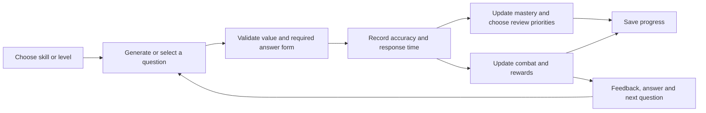

# NumSprite: public-code reverse-engineering report

Inspected: **23/10/2026** · Target: [NumSprite](https://numsprite.com/)

**Result:** the inspected build combines 12 mini-games, a 12-stage mathematics trail with 87 skills, Olympiad and IQ activities, combat, and a shared progression economy. Its browser code exposes enough rule and generation logic to specify independent teaching games. This report documents that logic; it does not claim to recover the private server implementation or original development repository.

The owner selected **public-code analysis only**. The homepage and terms were viewed before that choice; no game was started, no terms accepted, no account used and no service API was deliberately invoked. The normal webpage ran while being viewed. Downloaded scripts were subsequently treated as inert text, never imported or executed as an application.

## 1. What was inspected

- Captured **61 public files, 4,942,666 bytes**: the homepage, 3 CSS files and 57 JavaScript files. The added files were selected from the site's explicit cloud-service and mini-game import maps.
- Retained the original bytes, public URLs, acquisition times and SHA-256 hashes; all 61 files passed a fresh hash and length check.
- Ran **REA 6.7.0** on the initial homepage artifact set, then manually followed Turbopack factory IDs, exported functions and their callers. Formatted copies provide readable, repeatable line references.
- REA parsed 32 JavaScript files, skipped one after a worker heap limit, and reported no parse failures. Its semantic coverage is **partial**; the HTML inline scripts were not analysed by REA, and its module statistic was zero. Consequently, the detailed game conclusions below are manually traced static findings, not a claim that REA automatically reconstructed every module.
- The additional service and mini-game view files were inspected manually, outside the REA run's initial artifact boundary.

REA Evidence: `ev_498ea0b0830ea8afcefd035ad24a567cbfef9d9e2f644d9919aa16978eddaab4`.

Evidence labels used throughout: **static** means present in the captured code; **derived** means calculated from that code; **recommendation** is a proposed design choice. Live availability, network success and classroom effectiveness remain untested.

## 2. The 12 mini-games

The names and game IDs are explicitly listed in the [public catalogue bundle](https://numsprite.com/_next/static/chunks/2nj9koqcd_bj_.js). Detailed conditions, coin amounts, generators and source line references are in the [mini-game appendix](<C:/Users/t28ltk/Projects/lskc-maths (Chatgpt)/out/numsprite-research/minigame-findings.md>).

| Game                 | Recovered mechanics                                                                                                                                                                                                                             | Mathematical / teaching opportunity                                    |
| -------------------- | ----------------------------------------------------------------------------------------------------------------------------------------------------------------------------------------------------------------------------------------------- | ---------------------------------------------------------------------- |
| **Make 24**          | Combine four cards using +, −, × and ÷. Each operation replaces two cards with their result; the final card must be exactly 24. Uses exact rational arithmetic. Easy draws 1–9 and has an integer, nonnegative solution route; hard draws 1–13. | Arithmetic structure, fractions and explaining equivalent expressions. |
| **Matchstick Sums**  | Move segments of seven-segment digits and +/− signs to make a true equation. Easy: one move within a digit. Medium: one move between slots. Hard: two moves and no one-move solution.                                                           | Equality, systematic search and checking all constraints.              |
| **KenKen**           | 4×4, 5×5 or 6×6 Latin-square grid: each row/column contains 1–n once, with arithmetic cages. Generation accepts exactly one solution.                                                                                                           | Factors, arithmetic constraints and deduction.                         |
| **Sliding Tiles**    | 3×3 or 4×4 board, one blank; move adjacent tiles into ascending order. Generated through legal moves from a solved board. Records move count.                                                                                                   | Spatial planning, invariants and explaining a strategy.                |
| **Apple Tens**       | A 12×10 grid. Drag a rectangle whose remaining numbers sum to 10, then remove those cells. Timed mode has 120 seconds, combo multipliers, gold apples and clock bonuses; relaxed mode removes the countdown.                                    | Number bonds, decomposition and recognising useful groups.             |
| **One Line**         | 5×5, 6×6 or 7×7 board. Draw an orthogonal path from 1 through numbered checkpoints in order, visiting every square once. Generator checks uniqueness.                                                                                           | Constraint reasoning and planning ahead.                               |
| **2048**             | A 4×4 merge board. Equal tiles combine once per swipe; valid moves spawn 2 or 4. Targets are 256, 1024 and 2048 by difficulty.                                                                                                                  | Powers of two, doubling and strategy.                                  |
| **Minesweeper**      | Boards are 8×8/9 mines, 10×10/16 mines and 13×10/25 mines. First opening and its neighbours are safe. Clear all non-mine squares; flags and number chording are supported.                                                                      | Deduction from local constraints; distinguishing proof from guessing.  |
| **Balance Scales**   | Solve three sets of balanced equations per run. Easy has two fruit variables; medium/hard have three. Integer weights are 1–9. Easier levels support sequential substitution; hard requires simultaneous reasoning.                             | A strong bridge from pictures to algebra and simultaneous equations.   |
| **Race to 30**       | Players alternately add 1–3 to a running total; exactly 30 wins. Hard opponent uses a modular strategy. Ladder mode varies target and maximum addition.                                                                                         | Winning positions, remainders and generalisation.                      |
| **Dots and Boxes**   | Claim edges on 3×3, 4×4 or 5×5 boxes. Completing a box earns another turn; most boxes wins. Difficulty changes the opponent's heuristics.                                                                                                       | Counting, chains and strategic reasoning.                              |
| **Codebreaker 1A2B** | Guess 3, 4 or 5 distinct digits. A counts correct places; B counts correct digits in other places. Leading zero is allowed. Records number of guesses.                                                                                          | Logical elimination, permutations and choosing informative guesses.    |

The teaching opportunities are recommendations, not claims made by NumSprite or measured learning outcomes.

### Generation details that matter

**Solvability is handled differently by each game.** Make 24 uses a solver; KenKen and One Line explicitly check unique solutions; Sliding Tiles is solvable because its scramble uses legal moves. Apple Tens starts with a known complete decomposition into sum-10 rectangles, but a player's alternative removals can leave an unsolvable remainder. 2048 supplies no win guarantee. These are distinct contracts that an independent implementation should test separately. Sources: [game engines](https://numsprite.com/_next/static/chunks/2c363jifjb9ho.js), [KenKen engine](https://numsprite.com/_next/static/chunks/2nj9koqcd_bj_.js).

**Minesweeper has a bounded no-guess attempt, not an unconditional guarantee.** It tries up to 3,000 layouts and runs deduction checks, but returns the last sampled layout if none passes. The opening remains safe. The report therefore does not describe every board as solvable without guessing. Static location: `2c363jifjb9ho.js:4052–4118` in the readable copy.

**Difficulty can change the reasoning required.** Balance Scales uses a full-rank equation system, then checks whether sequential one-unknown substitution is possible. Its hard setting rejects that simple route. This is more useful for teaching than merely increasing the size of the numbers.

**Scores use different units.** Some games record seconds; Sliding Tiles records moves; Codebreaker records guesses; Apple Tens and 2048 record points. The captured progression code contains **83 mini-game stages** in total, with 6–8 per game. Free play opens after three cleared stages, subject to migration state. Thresholds use their game's own units.

### Hints and correction controls

The separately loaded game screens add useful teaching behaviour. Make 24 offers Undo and Reset; One Line offers backtracking and Restart. Minesweeper provides up to three successful logic hints per board, explaining the relevant deduction. Race to 30 and Dots and Boxes reveal progressive strategy explanations after unsuccessful rounds. Make 24 and Matchsticks unlock complete-answer reveals after 120 seconds or two failed attempts. Codebreaker uses 120 seconds or eight guesses; eight guesses is a reveal threshold, not an automatic loss. These are static screen-handler findings; exact references are in the mini-game appendix's lazy-view table.

## 3. The learning and combat loop

The following is a conceptual reconstruction of the inspected client flow. It is not a recorded execution trace.



**Curriculum.** The code declares 12 stages and 87 skills: number sense, addition/subtraction strategies, times tables, division, time/measures, larger-number techniques, factors/multiples, fractions/decimals, mixed operations, percentages/speed, shape/space and data handling. Each skill carries a generation specification, target response time, prerequisites and bilingual teaching explanations. The trail constructor produces **327 configured levels per route**; normal, dark and master arrays together contain 981 entries. Those are derived configuration counts, not verified live unlocks. The curriculum is chiefly primary mathematics, rather than a complete HKDSE syllabus. [Curriculum bundle](https://numsprite.com/_next/static/chunks/0m8ek9a82hzay.js).

**Practice selection.** Weak, slow and previously inaccurate facts receive higher selection weights; immediately repeated displays are strongly suppressed. Some competitive modes draw uniformly instead. This is weakness-weighted review; the inspected functions do not establish a full elapsed-time spaced-repetition scheduler. [Session engine](https://numsprite.com/_next/static/chunks/02rx1pctz4t0d.js).

**Mastery includes speed.** Enumerated facts use boxes 0–5. A quick correct response advances a box; a mistake drops two boxes; consistently slow correct responses stop advancing at box 2. Generative skills combine accuracy squared, median correct-answer time and up to 24 recent responses. An independent calculation gives **82.69% mastery for 100% accuracy at exactly the target median time**, once the sample-size factor is full—below the 85% mastery threshold. Thus the displayed mastery is a fluency measure, not accuracy alone.

**Answer form matters.** Fraction questions can require a reduced fraction. An answer equivalent to 1/2 may still be rejected if supplied as 2/4 or 0.5 when the requested form is a reduced fraction. The engine distinguishes correctness of value from the required notation. [Answer checker](https://numsprite.com/_next/static/chunks/15drmi75yc-kg.js).

**Combat.** Correct answers cause damage and build combos; speed can trigger critical hits. Mistakes, timed attacks, equipment, shields and revives affect health. Running out of questions while the enemy survives produces an escape rather than a win. Only a win advances the relevant trail completion. Normal stars depend on remaining health and revives; dark/master stars also depend on speed. Combat stars therefore mix learning performance with game state.

**Other learning modes.** The Olympiad map has six grades, 35 mapped topics and four difficulty zones; its actual stop count depends on available puzzle generators. Brain Lab lists 16 topics, including visual transformations, cube reasoning, logic and a separate brain-teaser track. The code supports visual models and step-based explanations, although their rendering was not tested.

Exact formulas, source locations and boundaries: [learning and combat appendix](<C:/Users/t28ltk/Projects/lskc-maths (Chatgpt)/out/numsprite-research/learning-findings.md>).

## 4. Architecture, saving and rewards

**Static architecture:** a Next.js/React browser application with Turbopack chunks, data-driven skill/game definitions, callable game functions and lazy-loaded screens. Storage and online features sit behind service adapters. The main state includes learning attempts, XP, coins, gems, energy, tickets, clothing, heroes, weapons, quests and game records.

**Saving:** guest progress uses localStorage. Signed-in progress has an account-specific local key and is merged with a Firestore document containing a JSON blob. Mutations save locally immediately; cloud saves are debounced for three seconds. Merge behaviour is field-specific: some values take maxima, ownership takes unions, and ticket counts have their own rules. This describes the client implementation, not a verified successful sync. [Local adapter](https://numsprite.com/_next/static/chunks/08s10zo9usa2_.js), [cloud adapter](https://numsprite.com/_next/static/chunks/0o-m894i0auaz.js).

| Mechanism              | Recovered client rule                                                                                                                         |
| ---------------------- | --------------------------------------------------------------------------------------------------------------------------------------------- |
| Player level           | Level L starts at `90 × (L − 1)²` XP.                                                                                                         |
| Energy                 | Capacity 60/80/120 at levels below 10 / 10–19 / 20+. Regenerates one point every two minutes; a new Hong Kong day restores at least capacity. |
| Mini-game tickets      | Separate pool of at most 8; adds 2 per three-hour Hong Kong-aligned window.                                                                   |
| Mini-game coin rewards | First three eligible wins per game record per Hong Kong day pay coins; later wins still update records.                                       |
| Daily gifts            | Date-based reward calculation with VIP variations; separate from streak protection.                                                           |
| Longer-term goals      | Daily/weekly quests, pass progress, collections, home decoration, heroes and equipment.                                                       |

The ordinary, skill and endless leaderboard adapters submit client-derived values to Firestore. Arena additionally calls server functions. **The deployed security rules and server validators are unknown**: seeing a client write does not establish whether the server accepts it or how it validates it.

One text/code discrepancy deserves attention: the general guide says longer streaks improve daily gifts, but the inspected ordinary daily-gift function is date-hashed and does not use streak length. This is a static discrepancy, not a reproduced player complaint. Full locations and qualifiers: [architecture appendix](<C:/Users/t28ltk/Projects/lskc-maths (Chatgpt)/out/numsprite-research/architecture-findings.md>).

## 5. What I would adapt for LSKC Maths

These are proposed original teaching designs, not recovered NumSprite requirements or implemented changes.

| Priority | Candidate                | Suggested classroom design                                                                                                                                                      |
| -------- | ------------------------ | ------------------------------------------------------------------------------------------------------------------------------------------------------------------------------- |
| 1        | **Balance Scales**       | Show an accurate balance beside its equation; allow teacher-controlled substitution/elimination steps. Move from pictures to symbols, with one representative F1/F2 case first. |
| 2        | **Make 24**              | Keep exact fractions and visible operation history. Ask pupils to explain their expression, compare alternative solutions and retry after a specific error.                     |
| 3        | **Race to 30**           | Let pupils discover 2, 6, 10, …, 30, then change the target and maximum step to investigate the general strategy.                                                               |
| 4        | **KenKen / Codebreaker** | Offer untimed deduction, optional hints that explain a constraint, and a record of the pupil's reasoning.                                                                       |

For a school implementation, keep mathematical correctness, response time and game rewards as separate records. Use an untimed learning mode and optional challenge timing. A shared architecture could be:

```text
Game definition → seeded generator → legal-action validator → state transition
                → result and explanation → local progress
```

Each game should have a clear generation contract: solvable, uniquely solvable, or intentionally open-ended. Original code, questions, explanations and artwork would form the implementation. In this repository, the existing app registry, central English copy, presentation mode and Firebase-free teaching-app pattern provide the integration route. No new game, dependency, deployment or production setting was added by this investigation.

## 6. Coverage and retained evidence

| Investigation question                                                             | Status                                                        |
| ---------------------------------------------------------------------------------- | ------------------------------------------------------------- |
| Identify all 12 catalogued mini-games                                              | Answered statically                                           |
| Recover rules, generation methods, scoring and progression                         | Answered at core-engine level; individual caveats in appendix |
| Trace learning, mastery, answer grading and combat                                 | Answered statically                                           |
| Describe cloud/local storage and reward systems                                    | Answered for the inspected client paths                       |
| Establish all live unlocks and active puzzle coverage                              | Unverified                                                    |
| Verify gameplay, animation, accessibility and phone layout                         | Not performed, following the chosen scope                     |
| Verify authenticated saving, actual server validation or all generated mathematics | Not performed                                                 |

Evidence folder: [NumSprite research](<C:/Users/t28ltk/Projects/lskc-maths (Chatgpt)/out/numsprite-research>).

- [Acquisition manifest](<C:/Users/t28ltk/Projects/lskc-maths (Chatgpt)/out/numsprite-research/manifest.json>), [service manifest](<C:/Users/t28ltk/Projects/lskc-maths (Chatgpt)/out/numsprite-research/services-manifest.json>), [mini-game view manifest](<C:/Users/t28ltk/Projects/lskc-maths (Chatgpt)/out/numsprite-research/games-manifest.json>).
- [Compact REA result and limitations](<C:/Users/t28ltk/Projects/lskc-maths (Chatgpt)/out/numsprite-research/rea-summary.json>). Full immutable REA output is retained as `rea-analysis.json`; the earlier temporary-file permission failure is retained separately as `rea-evidence.json`.
- [Integrity verification](<C:/Users/t28ltk/Projects/lskc-maths (Chatgpt)/out/numsprite-research/verification.json>).

The source snapshot and readable copies remain in the ignored research folder for local reference. This report is the reviewable project document; game-level findings cite the captured bytes rather than assuming the live site will retain the same build.
